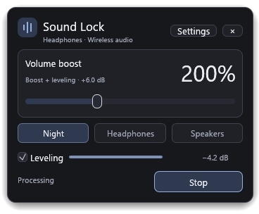
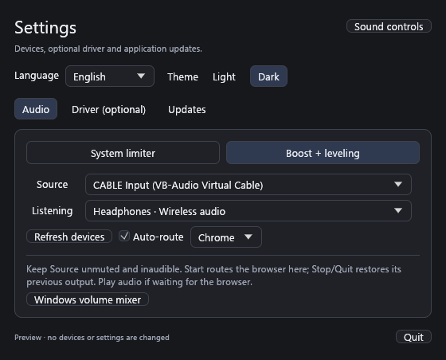
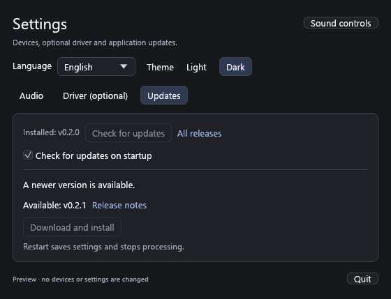
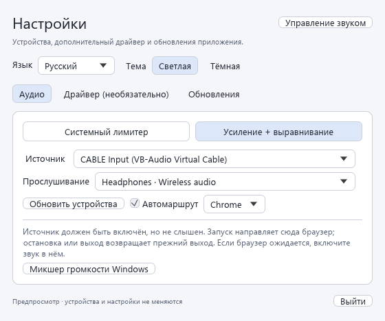
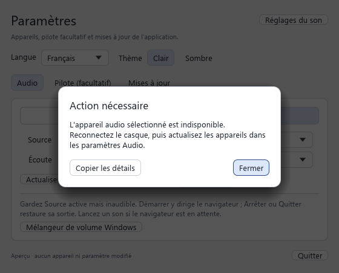

# Sound Lock

**Steady sound for movies.** A standalone Windows tray app written in Rust, with a multilingual tray popup, one main slider and Night / Headphones / Speakers profiles.

[Download the latest release](https://github.com/siarheisinelnikau/sound-lock/releases/latest) · [Release notes](https://github.com/siarheisinelnikau/sound-lock/releases/tag/v0.2.0) · [Release conventions](docs/releasing.md)

System limiter works without a browser extension, extra driver or administrator access. **Optional VB-CABLE setup is available inside the app** for full processing without a spare physical output. The two processing paths have different capabilities:

| Mode | Setup | What it does | Limit |
|---|---|---|---|
| **System limiter** (default) | Select your listening device | Reactively turns loud scenes down using Windows Core Audio; returns toward your starting volume afterward | Cannot amplify beyond the device maximum or catch the first transient |
| **Boost + leveling** | Route the player to optional VB-CABLE or an existing inaudible output | Real PCM leveling, compression, up to **400% (4× / +12.04 dB)** gain, and a 5 ms look-ahead sample-peak limiter | Requires a separate source endpoint; VB-CABLE provides it when only one physical listening device is available |

This is an early working prototype. Without an optional virtual driver or spare output it does **not** provide transparent system-wide 400% boost on a single endpoint. Ordinary WASAPI loopback captures playback without replacing it. See [Microsoft's loopback documentation](https://learn.microsoft.com/en-us/windows/win32/coreaudio/loopback-recording).

## Screenshots

Real application captures in preview mode, with simulated devices and no audio changes.







Light theme examples from the same application renderer:





## Download and run

Requires **Windows 10/11 x64**. Rust, administrator access and a driver are not required to run the System limiter.

| Download for v0.2.0 | Use |
|---|---|
| [SoundLock-v0.2.0.exe](https://github.com/siarheisinelnikau/sound-lock/releases/download/v0.2.0/SoundLock-v0.2.0.exe) | Portable app: download and run |
| [sound-lock-0.2.0-windows-x64.zip](https://github.com/siarheisinelnikau/sound-lock/releases/download/v0.2.0/sound-lock-0.2.0-windows-x64.zip) | Extract and run `sound-lock.exe`; includes README, screenshots and MIT license |
| [SHA256SUMS.txt](https://github.com/siarheisinelnikau/sound-lock/releases/download/v0.2.0/SHA256SUMS.txt) | SHA-256 checksums for both downloads |

Processing starts only when you press **Start**. A left click on the tray icon toggles the 368 × 304 quick panel: volume, profiles, leveling and Start/Stop. Clicking outside or pressing Esc dismisses it while audio keeps running. **Settings** opens a separate window for language, appearance, Audio, Driver and Updates; closing Settings leaves the app in the tray. Right-click the icon for sound controls, settings, update checks and Quit.

**Upgrading from 0.1.3 or earlier?** Quit the old version and download the current EXE manually once. The old updater cannot discover the renamed EXE. Your existing settings are preserved. Later compatible releases can be installed from **Settings > Updates**.

## Language and appearance

Open **Settings** from the popup or tray menu. **Language** and **Theme** are always available above the Audio / Driver / Updates tabs. Choose **English**, **Русский**, **Français**, **Deutsch**, **Español** or **Italiano**; labels, help, status messages and tray menus change immediately. **Light** and **Dark** also apply immediately to the popup, settings, inputs and detail dialogs. Both choices are saved with your existing audio preferences; previous settings start in English and the original dark theme.

Audio device names, browser names, file paths and detailed system/vendor diagnostics retain their original text. English is the complete fallback language. No restart, network translation service or recurring background work is needed to change language or appearance.

## Shared updater dependency

Build with Rust 1.95 or newer and keep `rust-auto-updator` beside this repository. Cargo resolves `../rust-auto-updator/crates/rust-auto-updator`; a checkout of Sound Lock alone is insufficient. CI and release runners must provision that sibling source before Cargo runs. No remote checkout URL is assumed until the library has a canonical published source. The library's MIT notice is included in `licenses/rust-auto-updator.txt` and release archives.

`assets/app.ico` embeds native 16, 20, 24, 32, 48, 64, 128 and 256px variants into the executable. Runtime window artwork uses the same equalizer mark; the tray rasterizes at the Windows small-icon metric. `scripts/inspect-icons.ps1 -ExecutablePath target/release/sound-lock.exe` loads packaged resources without starting the app and saves a light/dark native icon proof under `target/icon-proof`.

## Build from source

Requirements: Windows 10/11 x64, Rust 1.95+ with an [MSVC toolchain](https://rustup.rs/), and Visual Studio Build Tools with **Desktop development with C++**.

```powershell
cargo run --release --locked
```

Cargo builds `target\release\sound-lock.exe`. Release packaging names the standalone download `SoundLock-vVERSION.exe`; the executable inside the ZIP keeps its stable `sound-lock.exe` name.

## Tray workflow

The normal launch opens only the quick popup near the tray icon. `sound-lock.exe --startup` starts quietly in the tray; `--settings` opens Settings instead. These switches do not register Windows autostart. Both the graphite dark palette and the light palette use Segoe UI when installed and a muted blue accent. Popup placement stays within the work area of the tray monitor, including side/top taskbars and negative monitor coordinates.

## CPU rendering in development builds

The current source uses a CPU rasterizer with Windows GDI presentation, without an OpenGL or DirectX rendering backend. The popup uses per-pixel alpha and its own rounded border/shadow; Windows does not draw a second rectangular frame around it. This renderer is included in the 0.2.0 release.

The pinned software rasterizer retains its upstream [MIT](vendor/egui-software/LICENSE-MIT) / [Apache-2.0](vendor/egui-software/LICENSE-APACHE) licenses; both texts are included in newly packaged ZIP builds.

Static windows wait for input or a background result. Audio monitoring and delayed settings saves can run without painting Settings. Visible meter changes repaint the quick panel; unchanged readings do not. Windows expose events reuse the retained bitmap, and the event loop sleeps when no work is due. Font textures are rasterized at the current pixel density; popup positioning also accounts for UI zoom. See [CPU rendering validation](docs/validation-cpu.md) for measured conditions and limitations.

## Updates

Open **Settings > Updates** to see the installed version and use **Check for updates**. **Check for updates on startup** is enabled by default and can be turned off; the saved opt-out prevents startup requests. Checking is asynchronous, uses the public stable release API without login, and does not interrupt audio. A new version highlights Settings in the popup and appears in the tray menu/tooltip. Startup checks never open no-update or network-error dialogs. Prereleases and downgrades are not offered.

Click **Download and install** to download, verify and install the update, then restart. Startup checks never download or install an update; that requires your action. **Install later** defers the restart while the requested download continues; afterward use **Restart & install** when convenient. The app checks the official release URLs, expected sizes, SHA256SUMS manifest, GitHub's asset digest when present, and the Windows x64 executable header. Restart saves settings, restores browser/native audio and stops processing before handing over to the shared updater helper, copied from the verified new executable. The helper waits for that exact process to exit, replaces the EXE in place with a backup, then launches the new version. Settings and the executable's existing filename/location are preserved; processing remains stopped until you start it again.

If the new version exits before its first UI frame, the helper restores and relaunches the previous executable. If the new process is still alive after 30 seconds, it is left running and the backup is retained. After successful startup, only known staging files are cleaned up. The portable application folder must be writable; no automatic elevation is requested. Downloads and installation/recovery files are staged in a private `.sound-lock-update-*` folder beside the app. If recovery cannot complete, keep that folder and its `previous.exe` for diagnosis or manual restoration.

Update trust depends on HTTPS and this GitHub repository/account: the executable is currently unsigned, and a checksum delivered by the same release is not an independent publisher signature. **Install the current version manually when coming from 0.1.3 or earlier:** the release EXE adopted the `SoundLock-vVERSION.exe` naming pattern in 0.1.4, and the older updater only recognizes its historical filename pattern. The new updater understands canonical names and retains historical name support. No legacy-named EXE alias is published.

## System limiter

1. Keep your browser/player on its normal output.
2. Open **Settings > Audio**, choose **System limiter** and select that same listening device.
3. In the tray popup, select a profile, choose a **Peak limit**, and press **Start**. Lower targets reduce more peaks.

This mode reads the endpoint's pre-volume peak meter and temporarily attenuates its volume. It never raises the volume above your starting level. Night uses the slowest recovery; Speakers recovers faster. Keyboard/mixer volume changes become the new upper bound. Stop and normal Quit restore the last user-selected level if the app still owns the current setting. A crash, forced termination or power loss cannot run cleanup; Windows may retain the last attenuated level.

It is a reactive volume controller, **not a sample-accurate limiter**. The meter reports the preceding device period, and the worker polls every 10 ms. Exclusive-mode streams may bypass software metering or volume control on some hardware. [Microsoft documents the meter placement](https://learn.microsoft.com/en-us/windows/win32/api/endpointvolume/nn-endpointvolume-iaudiometerinformation) and [endpoint volume behavior](https://learn.microsoft.com/en-us/windows/win32/api/endpointvolume/nn-endpointvolume-iaudioendpointvolume).

## Optional VB-CABLE setup

Open **Settings > Driver (optional)** from the popup or the tray menu. System limiter remains driver-free; optional VB-CABLE enables the separate Boost + leveling path.

1. Click **Download driver**. Sound Lock downloads Pack 45 from the [official VB-Audio website](https://vb-audio.com/Cable/) and verifies its checksum. Downloading never launches an installer.
2. Click **Install driver…** separately. Sound Lock unpacks the complete package, verifies the setup executable's Windows signature, and opens the vendor's interactive installer with Windows UAC. Administrator access is required. Complete the vendor's setup yourself; no silent installation or automatic acceptance of license terms is performed.
3. Restart Windows, open the same panel and click **Refresh devices**, then **Use VB-CABLE**. This selects **Boost + leveling** with **CABLE Input** as its loopback source. Keep your real headphones/speakers as **Listening**.
4. In **Settings > Audio**, leave **Auto-route** enabled and select Chrome, Edge, Firefox, Brave, Opera or Vivaldi. Start processing and play something in that browser. Sound Lock sends it to **CABLE Input** and restores its previous output on Stop or Quit. Leave VB-CABLE's Loopback option enabled (the Pack 45 default).

```text
Browser/player -> CABLE Input (virtual, inaudible)
              -> Sound Lock DSP -> your headphones/speakers
```

Sound Lock captures the playback endpoint **CABLE Input**, not the recording endpoint CABLE Output. This is supported by VB-CABLE's loopback mode; see the [vendor's reference manual](https://vb-audio.com/Cable/VBCABLE_ReferenceManual.pdf). A second physical output is not needed with this route.

The installer itself can change Windows' default sound devices. Check those defaults after reboot and keep your physical headphones/speakers as the Windows default. An already detected VB-CABLE disables the install button, so opening setup does not inadvertently offer removal.

The driver is third-party software with [VB-Audio's own license](https://vb-audio.com/Services/licensing.htm); it is downloaded directly and is not bundled or relicensed under this repository's MIT license. Cached packages and extracted installer companions are kept in `%LOCALAPPDATA%\SoundLock\drivers\vb-cable-45`. If the vendor replaces the archive, checksum verification fails rather than launching unexpected content; the official website remains available as a fallback.

## Boost + leveling without installing a driver

Use an **already existing, inaudible second playback output**, such as an unused HDMI monitor endpoint without audible speakers:

```text
Browser/player -> unused playback output -> WASAPI loopback
              -> Sound Lock DSP -> physical headphones/speakers
```

1. Open **Settings > Audio**, select **Boost + leveling**, choose the unused output as **Source**, and your headphones as **Listening**.
2. Leave **Auto-route** enabled and select your browser.
3. Leave the source unmuted. Its original playback must be inaudible; loopback does not suppress it. Source and listening devices must differ to avoid feedback.
4. Start processing, play something in the selected browser and raise gain gradually from 100%.

If the source is audible you will hear both versions. Muting or zeroing that endpoint can also silence loopback on some devices, so it is not a reliable replacement for an inaudible source. With only one usable output, use **System limiter** or the optional VB-CABLE route above.

Media players also work: Boost + leveling processes all audio arriving at Source. Automatic routing and restoration currently cover only the selected browser. For Media Player or another app, disable Auto-route, assign its output to Source in Windows volume mixer, and restore its normal output manually after stopping Sound Lock.

## Automatic browser output

**Auto-route** is enabled by default for Boost + leveling. Choose one browser in **Settings > Audio**; Start opens the PCM bridge first, then switches that browser's registered audio processes to Source. All tabs using its normal audio output are affected. New audio processes are detected while processing runs, including after a browser restart. Stop and normal Quit restore the original per-app Console, Multimedia and Communications output preferences, including **Follow default**. System limiter never routes apps or changes the Windows default output.

Previous preferences are saved before switching in `%APPDATA%\SoundLock\browser-routing.json`. A partial start failure rolls back changes. Recovery retries while Sound Lock is open and on its next launch. If the browser has closed, open it and start playback so Windows can resolve its audio identity; pending recovery blocks a new automatic session until it completes. A force kill, crash or power loss cannot restore immediately: relaunch Sound Lock and play browser audio to recover. There is no background service after Quit.

When migrating an existing manual assignment to the selected Source (for example CABLE Input), Stop uses **Listening** so the browser remains audible. If the previous explicit device was disconnected, restoration uses the Windows default; if that default is Source, it uses Listening device instead.

This uses Windows' internal per-app audio policy interface, so compatibility with future Windows updates is not guaranteed. If routing is unavailable, Start reports the error and does not leave processing active. For another player, a site that explicitly selects its own sink, or manual control, disable **Auto-route**, use **Windows volume mixer** and restore that app's output yourself afterward. No browser extension, injection, driver installation or administrator access is needed for routing. Process paths/PIDs and audio-session metadata are used; tabs, URLs and audio content are not inspected.

The DSP is stereo-linked and includes gated upward leveling, a soft-knee compressor, smoothed manual gain and a sample-peak limiter. It raises quiet dialogue along with other quiet material; it does **not** separate speech from music/effects. 400% describes amplitude gain before limiting, not four times perceived loudness or a guarantee that already loud audio can become four times louder without distortion.

| DSP profile | Max automatic lift | Compressor ratio | Sample-peak ceiling |
|---|---:|---:|---:|
| Night | +12 dB | 6:1 | −3 dBFS |
| Headphones | +9 dB | 3.5:1 | −1.5 dBFS |
| Speakers | +6 dB | 2.5:1 | −1 dBFS |

Mono/stereo PCM only; f32, f64, i16, u16 and i32. Different sample rates use linear interpolation with slow clock-drift correction. Matching 48 kHz settings are preferable. Added buffering is about 40 ms plus 5 ms look-ahead and driver latency. No surround/passthrough, true-peak oversampling, speech separation or LUFS normalization. Protected DRM content may block capture.

## Development and validation

```powershell
cargo fmt --all -- --check
cargo clippy --workspace --all-targets --all-features --locked -- -D warnings
cargo test --workspace --locked
cargo build --release --locked
```

Read-only diagnostics (use the debug build for console output):

```powershell
cargo run -- --list-devices
cargo run -- --probe-system
cargo run -- --probe-routing
```

Offline DSP demonstration; opens no audio devices:

```powershell
cargo run -p soundlock-dsp --example render_demo -- .local/demo
```

Creates `before.wav` and `after.wav` from synthetic quiet scenes and bursts. This validates dynamics, not speech recognition or subjective movie quality. Audio is processed locally and is never uploaded or recorded. Optional driver setup downloads the official package over HTTPS and uses Windows signature verification; only the explicit offline example writes generated audio.

The normal test suite covers modal behavior, audio processing, transactional routing/recovery, updater integration and package handling. Shared release, integrity and replacement regressions live in `rust-auto-updator`. An opt-in native policy check switches and restores **only the test executable's own** preferences using an unstarted, silent audio session:

```powershell
cargo test --locked routing::windows::tests::real_policy_roundtrip_restores_own_process_preferences -- --ignored
```

An additional network-dependent check prepares the real driver package **without running its installer**:

```powershell
cargo test --locked driver::tests::official_package_prepares_without_installation -- --ignored
```

The shared updater has a bounded native smoke check. It replaces only temporary fixture executables and never launches Sound Lock or opens audio devices:

```powershell
cargo run --manifest-path ../rust-auto-updator/Cargo.toml -p rust-auto-updator --example native-smoke --features smoke-test --locked -- --test-updater
```

A real-window regression is available on an interactive Windows desktop:

```powershell
./scripts/test-tray.ps1
```

It uses preview mode with fake endpoints and no user settings writes. It exercises the actual installed tray callbacks, native visibility, toggle/dismiss, focus loss, separate Settings, minimize/restore, hidden commands and Quit. The `ui-capture` feature adds opt-in own-window PNG capture through `SOUND_LOCK_CAPTURE_TO` and `SOUND_LOCK_CAPTURE_VIEW` (`popup`, `audio`, `driver`, `updates`, `dialog`) when running with `--preview`. Production builds omit those QA features. Preview-only `SOUND_LOCK_LANGUAGE` accepts `en`, `ru`, `fr`, `de`, `es` or `it`; `SOUND_LOCK_THEME=light` selects the light palette. The normal default is English/dark. Capture has an eight-second readiness deadline; wrap the disposable process in an external timeout as well.

Settings: `%APPDATA%\SoundLock\settings.json`. Mode, slider values, update-check preference and stable device identifiers persist. Processing does not start automatically. Audio, Driver and Updates live in a separate, content-sized Settings window. Detail dialogs have a visible border, soft shadow and a dimmed, inactive background; close those dialogs with **Close** or Esc. The popup and Settings have no scrolling containers. There is no Sound Lock application installer, executable signing or Windows autostart yet.

See [architecture](docs/architecture.md), [manual checks](docs/manual-test.md) and [actual validation results](docs/validation.md). CI builds a Windows executable artifact.

## Release naming and publishing

Standalone downloads use **`SoundLock-vVERSION.exe`**, for example `SoundLock-v0.2.0.exe`. Add `-x64`, `-x86` or `-arm64` only when the **same release offers multiple executable architectures**. A ZIP, source archive or checksum file does not count as another architecture.

The Git tag is `vVERSION`, the release title is `Sound Lock vVERSION`, and the publishing commit's first line is exactly `Release vVERSION`. The current ZIP format remains `sound-lock-VERSION-windows-x64.zip`; it contains `sound-lock.exe`. Keep README links, uploaded filenames, updater selection and checksums consistent.

See [release conventions and publication steps](docs/releasing.md) for the full naming table, compatibility requirements and CI workflow. Documentation-only changes do not need a version bump or a new release.

## Source layout

```text
crates/soundlock-dsp/   dependency-free PCM dynamics core
src/system.rs          driver-free endpoint volume controller
src/audio.rs           WASAPI loopback bridge, queue and resampling
src/app.rs             shared popup/settings state and independent native viewports
src/popup.rs           tray anchoring, focus behavior and monitor/DPI placement
src/theme.rs           graphite surfaces, muted blue accent, borders and shadows
src/desktop/           reactive winit host, CPU rasterization and retained GDI bitmaps
src/tray.rs            Windows tray menu, icon callbacks and viewport wakeups
src/config.rs          profiles and persisted settings
src/driver.rs          optional official driver download and interactive setup
src/routing/           per-browser audio policy, durable recovery and ownership lock
src/update/            Product adapter and legacy startup receipts; shared updater owns release/download/install logic
```

Inspired by [Sound Lock from 3 APPES](https://www.3appes.com/en/sound-lock/). This is an independent implementation, not affiliated with 3 APPES. Browser-extension work belongs in a separate project.

MIT — [LICENSE](LICENSE).
