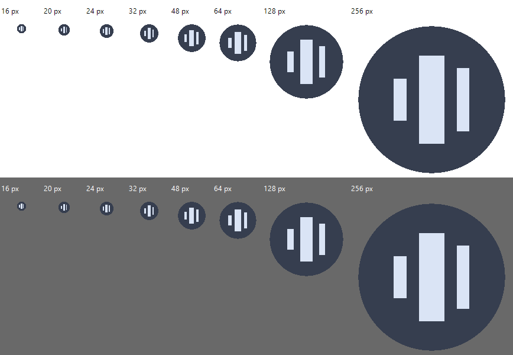

# Icon, updater and rendering audit — 2026-11-01

No computer-use APIs, desktop screenshots or input automation were used. The optimized all-feature executable was built with the sibling `rust-auto-updator` source. Its SHA-256 is recorded in the adjacent icon and CPU reports.

- Packaged icons loaded through native `LoadImageW` and rendered through `DrawIconEx` at 16, 20, 24, 32, 48, 64, 128 and 256 pixels. The light/dark PNG was inspected: intended equalizer artwork, valid alpha and no blank frame. At 16px the visible bounds are 15×15. Build-time EXE resources, runtime small/window icons and explicit taskbar ICON_BIG assignment are present. The tray now rasterizes at the Windows small-icon metric. OS tray clicks, menus, Explorer icon caching and mixed-DPI behavior were not exercised.
- Shared core owns release selection, integrity checking, download, staging, helper replacement and rollback. Local code contains product settings/presentation and the legacy first-frame receipt adapter only. Startup opt-out, manual checks, user-initiated installation, settings saving and audio restoration remain. The 30-second shared startup-health policy preserves rollback if the new child exits before its first presentation; the previous version receives an update-failed message.
- The actual published 0.1.3 helper replaced only an isolated fixture with this new binary. It validated the exact parent, waited for exit, observed the new CPU/GDI host's first-frame receipt and removed its known legacy staging files. The new preview exited after ten seconds. No real audio endpoints, user settings or installed application were touched.
- Settings-visible and hidden preview diagnostics each lasted ten seconds. After two-second warm-up, each recorded zero painted frames, zero logic calls and no input events. Five-second process CPU samples were below timer resolution on this 20-logical-CPU system. No OpenGL/D3D/DXGI modules were found; source and runtime trace identify the software rasterizer and direct GDI presentation. GPU/compositor telemetry and subjective input latency were not measured.
- A separate bounded own-framebuffer capture of Updates was inspected and saved as `docs/screenshots/update-settings.png`. It verifies client-area layout, not OS chrome or tray behavior.

Validation: formatter and all-target/all-feature Clippy pass. 36 application tests and 11 DSP tests pass; two existing network/audio-policy tests remain intentionally ignored. TEMP/TMP were redirected into the workspace because sandbox temporary-file replacement was denied in the default location. Shared native replacement/rollback regressions belong to the updater workspace.

The updater remains a local sibling path dependency. A repository-only CI checkout is insufficient until its source is provisioned; no unpublished remote URL is assumed. No release was published or altered.

